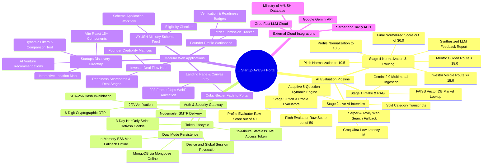
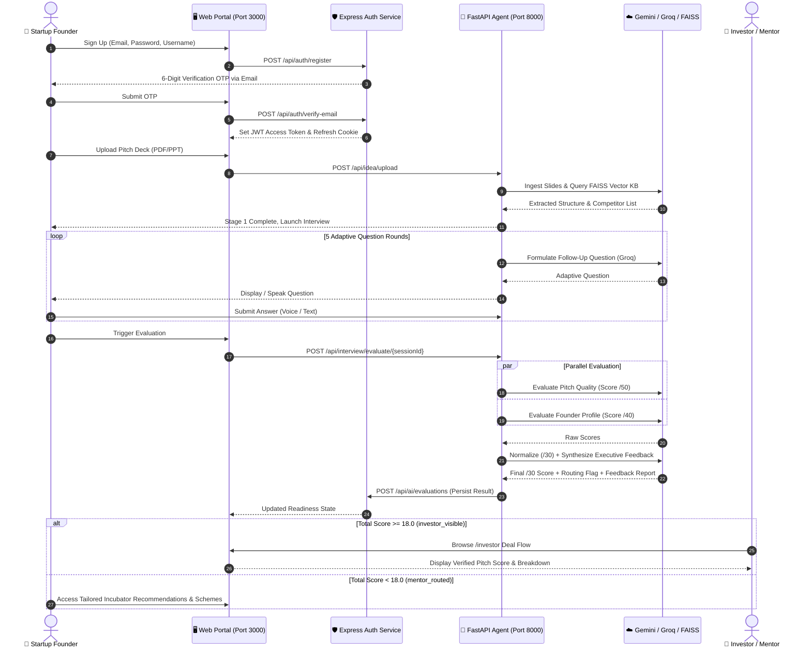
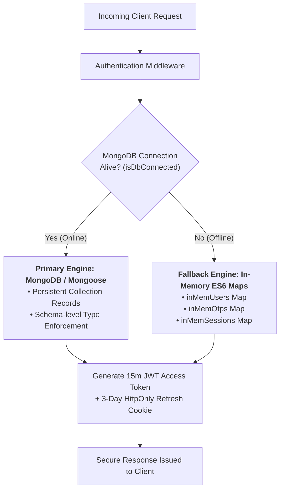

# 🌿 Startup-AYUSH Portal (WarriorHacks 2.0 / SIH 2026)
### Problem Statement: SIH1345 | Next-Gen AI Pitch Evaluation, Adaptive Interview & Investor Matching Ecosystem

<div align="center">

[](https://www.sih.gov.in/)
[](https://fastapi.tiangolo.com/)
[](https://python.org)
[](https://nodejs.org/)
[](https://expressjs.com/)
[](https://react.dev/)
[](https://vitejs.dev/)
[](https://tailwindcss.com/)
[](https://mongodb.com/)
[](https://deepmind.google/technologies/gemini/)
[](https://groq.com/)
[](https://opensource.org/licenses/ISC)

<br/>

> **An enterprise-grade, offline-resilient intelligence portal empowering AYUSH (Ayurveda, Yoga & Naturopathy, Unani, Siddha, Homeopathy) startups with automated multimodal deck ingestion, real-time adaptive AI interviews, FAISS competitor RAG verification, and dual-channel capital vs. incubator routing.**

[Key Features](#-key-features) • [System Mindmap](#-system-mindmap) • [Architecture](#-system-architecture) • [AI Pipeline](#-4-stage-ai-agent-evaluation-pipeline) • [Auth & Resilience](#-dual-mode-resilient-authentication--security) • [API Docs](#-api-reference) • [Quick Start](#-quick-start-guide)

</div>

---

## 📌 Table of Contents

- [🌿 Executive Overview & Problem Statement](#-executive-overview--problem-statement)
- [✨ Key Features](#-key-features)
- [🧠 System Mindmap](#-system-mindmap)
- [🏛️ System Architecture](#-system-architecture)
- [🤖 4-Stage AI Agent Evaluation Pipeline](#-4-stage-ai-agent-evaluation-pipeline)
  - [Stage 1: Multimodal Intake & Competitor RAG](#stage-1-idea-intake-agent-idea_intake_agentpy)
  - [Stage 2: Live Adaptive Interview Orchestrator](#stage-2-live-ai-interview-orchestrator-interview_orchestrator_agentpy)
  - [Stage 3: Dual Pitch & Profile Evaluators](#stage-3-pitch--profile-evaluators-pitch_evaluator_agentpy--profile_evaluator_agentpy)
  - [Stage 4: Normalization, Routing & Feedback Synthesis](#stage-4-scoring-feedback--routing-agent-scoring_feedback_agentpy)
- [🔄 End-to-End Execution Sequence](#-end-to-end-execution-sequence)
- [🧮 Mathematical Evaluation Model](#-mathematical-evaluation-model)
- [🔒 Dual-Mode Resilient Authentication & Security](#-dual-mode-resilient-authentication--security)
- [🎨 Modular Micro-Frontend Ecosystem](#-modular-micro-frontend-ecosystem)
- [📁 Repository Directory Structure](#-repository-directory-structure)
- [📡 API Reference](#-api-reference)
- [⚡ Quick Start Guide](#-quick-start-guide)
  - [Prerequisites](#prerequisites)
  - [Environment Setup](#environment-configuration)
  - [One-Command Master Launch](#running-the-full-platform)
  - [Port Allocation Matrix](#port-allocation-matrix)
- [🛡️ Production Resilience & Fallbacks](#-production-resilience--fallbacks)
- [🤝 Contributing & License](#-contributing--license)

---

## 🌿 Executive Overview & Problem Statement

The Indian AYUSH sector represents one of the fastest-growing healthcare and wellness frontiers globally. However, indigenous health startups face acute bottlenecks:

1. **Subjective & Manual Evaluation:** Government ministries and incubators receive thousands of unstandardized pitch decks, requiring weeks of manual review.
2. **Credibility & Scientific Benchmarking Gaps:** Traditional medicine ventures often lack standard biotech metric parity, making institutional venture capital hesitant.
3. **The "Cold Pitch" Dilemma:** Static pitch presentations cannot assess a founder's domain conviction, clinical insight, or regulatory preparedness.
4. **Fragmented Ecosystem Routing:** Founders struggle to identify relevant Ministry of AYUSH schemes, while investors cannot filter verified, high-scoring AYUSH opportunities.

### 💡 The Startup-AYUSH Portal Solution

Our platform solves this with a cohesive, full-stack, AI-native infrastructure:
- **Multimodal Pitch Ingestion:** Ingests PDF/PPT decks, extracting structured financial, clinical, and traction signals using Google Gemini 2.0 Flash.
- **RAG & Live Web Verification:** Cross-checks claims against a local **FAISS CPU Vector Database** and live web intelligence (`Serper.dev` / `Tavily`).
- **Low-Latency Adaptive Interview:** Groq-accelerated LLMs conduct an interactive 5-question dynamic cross-examination that actively probes deck weaknesses.
- **Calibrated Scoring (/30) & Intelligent Routing:** Scores pitch and team viability, routing high-potential ventures ($\ge 18.0$) to **Investor Deal Flow** and developmental ventures ($< 18.0$) to **Incubator Mentorship**.
- **Dual-Mode Offline Resilience:** Guaranteed uptime during hackathon demos and remote network dropouts via automated in-memory MongoDB failover.

---

## ✨ Key Features

| Capability | Technical Implementation | Impact |
| :--- | :--- | :--- |
| **🤖 4-Stage AI Pipeline** | Python, FastAPI, Gemini 2.0 Flash, Groq LLM, FAISS CPU | Automated, impartial evaluation completed in < 90 seconds |
| **🎙️ Live Adaptive Interview** | Voice/Text UI, Groq ultra-low latency, Dynamic Follow-ups | Tests founder conviction beyond static pitch deck claims |
| **🔍 Competitor RAG & Web Search** | FAISS Vector Store (`IndexFlatL2`) + Serper / Tavily APIs | Instant verification of claimed uniqueness against market realities |
| **📊 Calibrated /30 Normalization** | $\left(\frac{\text{Pitch}}{50}\times 19.5\right) + \left(\frac{\text{Profile}}{40}\times 10.5\right)$ | Transparent, mathematically grounded investment readiness score |
| **🚦 Threshold-Based Routing** | Auto-routing: $\ge 18.0 \rightarrow \text{Investor}$, $< 18.0 \rightarrow \text{Mentor}$ | Eliminates manual sorting for Ministry administrators |
| **🛡️ Dual-Mode Auth Gateway** | MongoDB Mongoose with seamless In-Memory ES6 Map failover | 100% demo uptime even without local MongoDB running |
| **🔐 Two-Factor Email OTP** | Nodemailer SMTP + SHA-256 OTP hashing + JWT Refresh Cookies | Bank-grade security with stateless token revocation |
| **🎨 5 Specialized Frontends** | React 18, Vite 5, Tailwind CSS, HTML5 Canvas 202-frame sequence | Distinct dedicated portals for Public, Founders, and Investors |

---

## 🧠 System Mindmap



---

## 🏛️ System Architecture

```mermaid
flowchart TD
    %% Styling Classes
    classDef clientStyle fill:#e8f5e9,stroke:#2e7d32,stroke-width:2px,color:#1b5e20;
    classDef authStyle fill:#e3f2fd,stroke:#1565c0,stroke-width:2px,color:#0d47a1;
    classDef aiStyle fill:#fff3e0,stroke:#e65100,stroke-width:2px,color:#bf360c;
    classDef storeStyle fill:#f3e5f5,stroke:#7b1fa2,stroke-width:2px,color:#4a148c;
    classDef cloudStyle fill:#eceff1,stroke:#455a64,stroke-width:2px,color:#263238;

    subgraph ClientLayer["🖥️ Client Presentation Layer (Micro-Frontends)"]
        LandingUI["Mandala Canvas Intro<br/><code>Port 5000 / Gateway</code>"]:::clientStyle
        HomeUI["Main AYUSH Portal<br/><code>Frontend/Home_Page</code>"]:::clientStyle
        StartupsUI["Startups Directory App<br/><code>Port 5173 (React/Vite)</code>"]:::clientStyle
        InvestorUI["Investor Deal Flow<br/><code>Port 5174 (React/Vite)</code>"]:::clientStyle
        SchemesUI["AYUSH Schemes Feed<br/><code>Port 5175 (React/Vite)</code>"]:::clientStyle
        ProfileUI["Founder Profile Workspace<br/><code>Port 5176 (React/Vite)</code>"]:::clientStyle
        InterviewUI["Live AI Interview Client<br/><code>Port 5500 (HTML/JS)</code>"]:::clientStyle
    end

    subgraph AuthGateway["🛡️ Express & Node.js Gateway (Port 3000)"]
        GatewayRouter["Express Router & Static Gateway<br/><code>src/app.js</code>"]:::authStyle
        AuthCtrl["Authentication Controller<br/><code>auth.controllers.js</code>"]:::authStyle
        PitchCtrl["Pitch & Evaluation API<br/><code>pitch.controllers.js</code>"]:::authStyle
        EmailSvc["Nodemailer SMTP Client<br/><code>email.service.js</code>"]:::authStyle
    end

    subgraph DataPersistence["💾 Dual-Mode Persistence Layer"]
        MongoDB[("MongoDB Database<br/>Users / Sessions / Pitches")]:::storeStyle
        InMemDB[("In-Memory ES6 Stores<br/>(Auto Offline Failover)")]:::storeStyle
        FAISS[("FAISS CPU Vector Store<br/><code>knowledge_base.faiss</code>")]:::storeStyle
    end

    subgraph AIPipeline["🤖 Python FastAPI Intelligence Core (Port 8000)"]
        FastAPIServer["FastAPI Server<br/><code>interview_api.py</code>"]:::aiStyle
        Orchestrator["Pipeline Orchestrator<br/><code>pipeline_orchestrator.py</code>"]:::aiStyle
        Stage1["Stage 1: Idea Intake Agent<br/><code>idea_intake_agent.py</code>"]:::aiStyle
        Stage2["Stage 2: Interview Agent<br/><code>interview_orchestrator_agent.py</code>"]:::aiStyle
        Stage3["Stage 3: Pitch & Profile Evaluators<br/><code>pitch/profile_evaluator_agent.py</code>"]:::aiStyle
        Stage4["Stage 4: Scoring & Routing Agent<br/><code>scoring_feedback_agent.py</code>"]:::aiStyle
    end

    subgraph CloudAPIs["☁️ External Cognitive & Web Services"]
        Gemini["Google Gemini 2.0 Flash API<br/>(Multimodal Deck Extraction & Evaluation)"]:::cloudStyle
        Groq["Groq Cloud LLM Engine<br/>(Mixtral-8x7b / Llama3-70b QA)"]:::cloudStyle
        Search["Serper.dev / Tavily Web API<br/>(Live Competitor Validation)"]:::cloudStyle
    end

    %% Client Routing
    LandingUI --> GatewayRouter
    HomeUI --> GatewayRouter
    ProfileUI --> GatewayRouter
    InterviewUI --> FastAPIServer
    StartupsUI -.-> InvestorUI

    %% Gateway to Controllers & Data
    GatewayRouter --> AuthCtrl
    GatewayRouter --> PitchCtrl
    AuthCtrl --> EmailSvc
    AuthCtrl --> MongoDB
    AuthCtrl -.->|DB Disconnected| InMemDB
    PitchCtrl --> MongoDB
    PitchCtrl -.->|DB Disconnected| InMemDB

    %% Gateway & AI Communication
    ProfileUI -->|Trigger Evaluation| FastAPIServer
    FastAPIServer --> Orchestrator
    Orchestrator --> Stage1
    Orchestrator --> Stage2
    Orchestrator --> Stage3
    Orchestrator --> Stage4

    %% Agent Interactions
    Stage1 --> Gemini
    Stage1 --> FAISS
    Stage1 --> Search
    Stage2 --> Groq
    Stage3 --> Gemini
    Stage4 --> Gemini

    %% Evaluation Return
    Stage4 -->|Normalized /30 Score & Report| PitchCtrl
```



---

## 🤖 4-Stage AI Agent Evaluation Pipeline

The intelligence core is structured as four coordinated Python agents executed under an event-driven FastAPI server.

```mermaid
flowchart LR
    %% Styles
    classDef agentBox fill:#ffffff,stroke:#1e88e5,stroke-width:2px,color:#0d47a1;
    classDef inputStyle fill:#e1f5fe,stroke:#0288d1,stroke-width:1px,color:#01579b;
    classDef outStyle fill:#e8f5e9,stroke:#388e3c,stroke-width:1px,color:#1b5e20;
    classDef routeStyle fill:#fff8e1,stroke:#fbc02d,stroke-width:2px,color:#f57f17;

    Deck["📄 Pitch Deck<br/>(PDF/PPT)"]:::inputStyle --> Stage1["<b>Stage 1: Intake Agent</b><br/>Gemini 2.0 + FAISS RAG"]:::agentBox
    Stage1 --> DeckSummary["Structured Deck JSON &<br/>Competitor Benchmark"]:::outStyle

    DeckSummary --> Stage2["<b>Stage 2: Live Interview</b><br/>Groq Adaptive Engine"]:::agentBox
    FounderAnswers["🎙️ Founder Answers<br/>(5 Dynamic Rounds)"]:::inputStyle --> Stage2
    Stage2 --> Transcripts["Split Transcripts<br/>(Idea Q&A + Profile Q&A)"]:::outStyle

    Transcripts --> Stage3A["<b>Stage 3A: Pitch Evaluator</b><br/>Market, Traction, Model (/50)"]:::agentBox
    Transcripts --> Stage3B["<b>Stage 3B: Profile Evaluator</b><br/>Team, Expertise, Tech (/40)"]:::agentBox

    Stage3A --> SubScores["Raw Pitch Score /50 &<br/>Raw Profile Score /40"]:::outStyle
    Stage3B --> SubScores

    SubScores --> Stage4["<b>Stage 4: Scoring & Routing</b><br/>Normalization & LLM Synthesis"]:::agentBox
    Stage4 --> FinalScore["<b>Final Score / 30.0</b><br/>(Pitch 19.5 + Profile 10.5)"]:::outStyle

    FinalScore --> Decision{"Score Threshold<br/>>= 18.0 ?"}:::routeStyle
    Decision -- Yes --> RouteA["🚀 <b>investor_visible</b><br/>Featured on Investor Deal Flow"]:::outStyle
    Decision -- No --> RouteB["🌱 <b>mentor_routed</b><br/>Routed to Incubator Guidance"]:::outStyle
```



---

### Stage 1: Idea Intake Agent (`idea_intake_agent.py`)
- **Multimodal Deck Ingestion:** Extracts text, slide structures, and visual elements from uploaded PDF/PPT decks using Google Gemini 2.0 Flash.
- **Competitor RAG Verification:** Queries a local **FAISS CPU Vector Store** (`knowledge_base.faiss`) containing historical AYUSH enterprise profiles to check claims against prior ventures.
- **Live Search Fallback:** If vector cosine similarity drops below threshold, triggers `Serper.dev` or `Tavily` search to identify live market competitors.
- **Output:** A structured JSON summary with market sizing, problem validation, product claims, identified competitors, and initial confidence flags.

### Stage 2: Live AI Interview Orchestrator (`interview_orchestrator_agent.py`)
- **Low-Latency Interrogation:** Powered by **Groq** (`mixtral-8x7b-32768` / `llama-3.1-70b-versatile`) delivering sub-500ms responses.
- **5-Question Adaptive Trajectory:** Dynamically generates follow-up questions tailored to gaps detected in the Stage 1 deck summary and founder's prior answers.
- **Transcript Tagging:** Segregates conversation logs into two discrete streams:
  1. `transcript_idea_qa`: Strategy, problem formulation, TAM/SAM, unit economics.
  2. `transcript_profile_qa`: Founder background, technical acumen, domain compliance, and team composition.

### Stage 3: Pitch & Profile Evaluators (`pitch_evaluator_agent.py` & `profile_evaluator_agent.py`)
- **Stage 3A (Pitch Evaluator Agent):**
  - **Rubric (/50):** Problem Definition (10), Market Size & Opportunity (10), Business Model & Pricing (10), Product Moat & Feasibility (10), Traction & Milestones (10).
- **Stage 3B (Profile Evaluator Agent):**
  - **Rubric (/40):** Domain Knowledge & AYUSH Expertise (10), Technical Capacity (10), Team Completeness (10), Regulatory & Clinical Awareness (10).

### Stage 4: Scoring, Feedback & Routing Agent (`scoring_feedback_agent.py`)
- **Score Normalization:** Translates raw scores into a final index out of **30.0**:
  - Pitch component normalized to **19.5 points max**.
  - Profile component normalized to **10.5 points max**.
- **Automated Routing:**
  - $\text{Total Score} \ge 18.0 \rightarrow \mathbf{\text{investor\_visible}}$ (Published to Investor Deal Flow).
  - $\text{Total Score} < 18.0 \rightarrow \mathbf{\text{mentor\_routed}}$ (Directed to Incubators & Mentorship Workshops).
- **Executive Feedback Synthesis:** Generates a 3-part structured LLM assessment report highlighting Top Strengths, Vulnerabilities, and 90-Day Recommendations.

---

## 🔄 End-to-End Execution Sequence



---

## 🧮 Mathematical Evaluation Model

Our scoring engine eliminates subjective reviewer bias through strict proportional scaling:

### 1. Sub-Score Normalization Formulas

$$\text{Pitch Subtotal Normalized} = \left(\frac{\text{Pitch Raw Score}}{50}\right) \times 19.5$$

$$\text{Profile Subtotal Normalized} = \left(\frac{\text{Profile Raw Score}}{40}\right) \times 10.5$$

$$\mathbf{\text{Total Score (Out of 30.0)}} = \text{Pitch Subtotal Normalized} + \text{Profile Subtotal Normalized}$$

### 2. Dimension Weights & Distribution

| Dimension | Raw Max | Scaled Max | Percentage Contribution | Evaluated Competency |
| :--- | :---: | :---: | :---: | :--- |
| **Pitch & Strategy** | 50 pts | **19.5 pts** | **65.0%** | Problem clarity, Market validation, Business model, TAM/SAM, Moat |
| **Founder & Team** | 40 pts | **10.5 pts** | **35.0%** | Domain knowledge, AYUSH expertise, Technical capability, Team depth |
| **Combined Total** | 90 pts | **30.0 pts** | **100.0%** | Holistic Investment Readiness Index |

### 3. Threshold Routing Logic

$$\text{Status Flag} = \begin{cases} 
\mathbf{\text{investor\_visible}}, & \text{if } \text{Total Score} \ge 18.0 \quad (60.0\%) \\
\mathbf{\text{mentor\_routed}}, & \text{if } \text{Total Score} < 18.0 \quad (< 60.0\%)
\end{cases}$$

---

## 🔒 Dual-Mode Resilient Authentication & Security



### Security Architecture Highlights
1. **Zero-Downtime Database Failover:** Every controller dynamically queries `isDbConnected()`. If MongoDB is unavailable (common in hackathon Wi-Fi environments), the server automatically routes state to memory maps without crashing.
2. **2FA Cryptographic Verification:** Generates a 6-digit random code, computes a `SHA-256` hash with salt, stores the hash with a 10-minute TTL, and sends the plaintext code via **Nodemailer SMTP**.
3. **Stateless + Stateful Token Defense:**
   - **Access Token:** Signed JWT valid for 15 minutes, carried in authorization headers.
   - **Refresh Token:** Stored in a strict `HttpOnly`, `SameSite=Strict` cookie valid for 3 days.
   - **Multi-Device Revocation:** Supports targeted logout (`/logout`) or global device revocation (`/logout-all`).

---

## 🎨 Modular Micro-Frontend Ecosystem

The client layer consists of 5 dedicated frontends serving distinct operational workflows:

```
Frontend/
├── starting page/        # Root Entry & Mandala Canvas Animation (Port 5000 / Gateway)
├── Home_Page/            # AYUSH Portal Navigation Hub
├── Startups/             # React + Vite Startups Discovery Directory (Port 5173)
├── investor/             # React + Vite Investor Deal Flow Dashboard (Port 5174)
├── schemes/              # React + Vite AYUSH Government Schemes Feed (Port 5175)
├── profile/              # React + Vite Founder Profile Workspace (Port 5176)
└── (Agent/)
    └── interview_dashboard.html # Standalone AI Interview Interface (Port 5500)
```

### Frontend Applications Breakdown

| Sub-Application | Port | Stack | Key Capabilities |
| :--- | :---: | :--- | :--- |
| **Mandala Intro Canvas** | `3000` / `5000` | Vanilla JS + HTML5 Canvas | Pre-renders 202-frame 24fps WebP sequence with cubic-bezier transition into `#F7F4EE`. |
| **Startups Directory** | `5173` | React 18, Vite 5, Tailwind CSS | 15+ components: multi-tag filtering, venture comparison matrix, interactive map, and AI matching. |
| **Investor Dashboard** | `5174` | React 18, Vite 5, Tailwind CSS | Deal-flow pipeline, risk scorecards, AI pitch breakdown, founder shortlist, and connection requests. |
| **AYUSH Schemes Feed** | `5175` | React 18, Vite 5, Lucide Icons | Ministry of AYUSH schemes database, eligibility assessment calculator, and application tracker. |
| **Founder Profile Workspace** | `5176` | React 18, Vite 5, Tailwind CSS | Verification status, pitch readiness meter, venture metrics, and dynamic evaluation report view. |
| **AI Interview Client** | `5500` | HTML5, Modern CSS, Web APIs | Real-time question streamer, audio synthesis support, answer capture, and evaluation trigger. |

---

## 📁 Repository Directory Structure

```
Warriorhacks-2.0/
├── package.json                       # Master dev runner (concurrently launches all tiers)
├── PROJECT_CONTEXT.md                 # Deep technical blueprint & architectural specification
├── README.md                          # Comprehensive project documentation
├── vercel.json                        # Cloud deployment configuration
│
├── Agent/                             # Python AI Intelligence Ecosystem
│   ├── interview_api.py               # FastAPI server exposing AI evaluation endpoints
│   ├── pipeline_orchestrator.py       # Master 4-agent workflow orchestrator
│   ├── idea_intake_agent.py           # Stage 1: Deck ingestion & FAISS competitor search
│   ├── interview_orchestrator_agent.py# Stage 2: Adaptive AI interviewer (Groq)
│   ├── pitch_evaluator_agent.py       # Stage 3A: Pitch & strategy evaluator (Gemini)
│   ├── profile_evaluator_agent.py     # Stage 3B: Founder & team evaluator (Gemini)
│   ├── scoring_feedback_agent.py     # Stage 4: /30 normalization, routing & report generator
│   ├── seed_kb.py                     # Vector DB population script
│   ├── knowledge_base.faiss           # Indexed FAISS CPU vector knowledge base
│   ├── interview_dashboard.html       # Standalone live AI interview frontend
│   ├── requirements.txt               # Python dependencies
│   └── .env                           # API keys (Gemini, Groq, Serper, Tavily)
│
├── Authentication/                    # Node.js + Express Gateway & Auth Service
│   ├── server.js                      # HTTP server entry point (Port 3000)
│   ├── package.json                   # Backend dependencies
│   ├── public/                        # Auth login/signup modal styles & scripts
│   └── src/
│       ├── app.js                     # Express app, CORS, cookies & static route handlers
│       ├── config/
│       │   ├── config.js              # Environment variable loader
│       │   └── database.js            # MongoDB Mongoose connection builder
│       ├── controllers/
│       │   └── auth.controllers.js    # Auth, OTP, session & token controllers
│       ├── middlewares/
│       │   └── auth.middleware.js     # JWT verification & session validation middleware
│       ├── models/
│       │   ├── user.model.js          # User schema
│       │   ├── otp.model.js           # OTP verification schema
│       │   └── session.model.js       # Session token schema
│       ├── routes/
│       │   └── auth.routes.js         # API endpoints for /api/auth
│       └── service/
│           └── email.service.js       # Nodemailer SMTP transporter
│
└── Frontend/                          # Modular Frontends
    ├── package.json                   # Sub-application concurrently runner
    ├── starting page/                 # Landing Page & 202-frame Canvas Animation
    │   ├── index.html                 # Canvas animation & entry portal
    │   ├── script.js                  # 202-frame WebP sequence renderer
    │   └── landing_frames/            # 202 pre-rendered WebP frames
    ├── Home_Page/                     # AYUSH Portal main overview hub
    ├── Startups/                      # Vite + React Startups Directory (Port 5173)
    ├── investor/                      # Vite + React Investor Dashboard (Port 5174)
    ├── profile/                       # Vite + React Founder Profile App (Port 5176)
    └── schemes/                       # Vite + React Government Schemes Feed (Port 5175)
```

---

## 📡 API Reference

### 1. Authentication Service (`http://localhost:3000/api/auth`)

| Method | Endpoint | Description | Auth Required |
| :--- | :--- | :--- | :---: |
| `POST` | `/register` | Create account, hash password & dispatch 6-digit OTP email | No |
| `POST` | `/verify-email` | Validate 6-digit OTP, mark account verified & issue tokens | No |
| `POST` | `/login` | Authenticate credentials & issue Access/Refresh tokens | No |
| `GET` | `/get-me` | Retrieve authenticated user profile from Bearer token | Bearer Token |
| `GET` | `/refresh-token` | Rotate refresh cookie & issue fresh 15-minute access token | Cookie |
| `GET` | `/logout` | Invalidate current device session & clear cookies | Cookie |
| `GET` | `/logout-all` | Revoke all active sessions across all devices | Cookie |

### 2. Pitch & Evaluation Persistence (`http://localhost:3000/api`)

| Method | Endpoint | Description | Auth Required |
| :--- | :--- | :--- | :---: |
| `POST` | `/pitches` | Create pitch record with founder details and deck URL | Bearer Token |
| `GET` | `/pitches/:pitchId` | Retrieve pitch status, score, and routing flag | Bearer Token |
| `POST` | `/ai/evaluations` | Save 4-agent evaluation result and enforce routing state | Bearer Token |

### 3. AI Evaluation Pipeline (`http://localhost:8000/api`)

| Method | Endpoint | Description | Payloads / Output |
| :--- | :--- | :--- | :--- |
| `POST` | `/idea/upload` | Upload PDF/PPT pitch deck & run Stage 1 RAG extraction | Multipart Form `file` $\rightarrow$ JSON Deck Summary |
| `POST` | `/interview/start` | Initialize Stage 2 live AI interview session | `{ pitch_id: string }` $\rightarrow$ `{ session_id: string, question: string }` |
| `POST` | `/interview/answer` | Submit answer & receive adaptive follow-up | `{ session_id, answer }` $\rightarrow$ `{ next_question, round }` |
| `GET` | `/interview/result/{id}`| Fetch split transcripts for evaluation | Transcripts: `transcript_idea_qa` & `transcript_profile_qa` |
| `POST` | `/interview/evaluate/{id}`| Trigger Stage 3 & 4 full 4-agent evaluation | Complete evaluation JSON with normalized `/30` score & feedback |
| `GET` | `/health` | Check FastAPI server health and active memory sessions | Server Status & Active Sessions count |

---

## ⚡ Quick Start Guide

### Prerequisites
- **Node.js:** `v18.0.0` or higher
- **Python:** `v3.10` or higher
- **MongoDB:** *(Optional)* Local instance or MongoDB Atlas. *Automatically falls back to In-Memory storage if absent.*
- **Package Manager:** `npm` (v9+) & `pip`

---

### Environment Configuration

#### 1. Configure AI Agent Environment (`Agent/.env`)
```env
# Required for Deck Ingestion and Evaluations
GEMINI_API_KEY=your_google_gemini_api_key

# Required for Live Low-Latency Interview
GROQ_API_KEY=your_groq_api_key

# Optional: Live Market Competitor Search
SERPER_API_KEY=your_serper_dev_api_key
TAVILY_API_KEY=your_tavily_api_key
```

#### 2. Configure Authentication Service (`Authentication/.env`)
```env
PORT=3000
# Optional: Leaves online if MongoDB running, falls back automatically if omitted
MONGO_URI=mongodb://127.0.0.1:27017/ayush_auth

# JWT Secret for signing 15-minute access tokens
JWT_SECRET=super_secret_jwt_key_sih2026_warriorhacks

# SMTP Credentials for delivering 6-digit OTP verification codes
EMAIL_USER=your_email@gmail.com
EMAIL_PASS=your_email_app_password
```

---

### Installation

```bash
# 1. Clone repository
git clone https://github.com/Anu7276/Warriorhacks-2.0.git
cd Warriorhacks-2.0

# 2. Install root dependencies
npm install

# 3. Install Authentication backend dependencies
cd Authentication && npm install && cd ..

# 4. Install Frontend dependencies
cd Frontend && npm install
cd Startups && npm install && cd ..
cd profile && npm install && cd ..
cd schemes && npm install && cd ..
cd investor && npm install && cd ../..

# 5. Install Python AI Agent dependencies
cd Agent
pip install -r requirements.txt
cd ..
```

---

### Running the Full Platform

#### Option A: One-Command Master Launch (Recommended)
Run all 8 microservices, gateways, and AI servers simultaneously via the master concurrently script:

```bash
npm run dev
```

#### Option B: Individual Service Commands
If running services individually in separate terminals:

```bash
# Terminal 1: Auth & Gateway Server (Port 3000)
cd Authentication && npm run dev

# Terminal 2: Python FastAPI Agent Backend (Port 8000)
cd Agent && uvicorn interview_api.py --reload --port 8000

# Terminal 3: Live AI Interview HTML Client (Port 5500)
cd Agent && npx serve -l 5500 .

# Terminal 4: Frontend Sub-Applications
cd Frontend && npm run dev
```

---

### Port Allocation Matrix

| Service / Interface | Technology | Local Port / Endpoint URL |
| :--- | :--- | :--- |
| **Master Express Gateway & Auth** | Node.js + Express 5 | [`http://localhost:3000`](http://localhost:3000) |
| **Mandala Canvas Intro** | HTML5 Canvas / Serve | [`http://localhost:5000`](http://localhost:5000) |
| **Startups Discovery Directory** | Vite 5 + React 18 | [`http://localhost:5173`](http://localhost:5173) |
| **Investor Deal Flow Dashboard** | Vite 5 + React 18 | [`http://localhost:5174`](http://localhost:5174) |
| **AYUSH Ministry Schemes Feed** | Vite 5 + React 18 | [`http://localhost:5175`](http://localhost:5175) |
| **Founder Profile Workspace** | Vite 5 + React 18 | [`http://localhost:5176`](http://localhost:5176) |
| **Live AI Interview Dashboard** | HTTP Static Server | [`http://localhost:5500/interview_dashboard.html`](http://localhost:5500/interview_dashboard.html) |
| **Python FastAPI Intelligence API**| FastAPI + Uvicorn | [`http://localhost:8000`](http://localhost:8000) / [`/docs`](http://localhost:8000/docs) |

---

## 🛡️ Production Resilience & Fallbacks

```
┌─────────────────────────────────┐
│     Production Resilience       │
└────────────────┬────────────────┘
                 │
  ┌──────────────┼──────────────┬──────────────┐
  │              │              │              │
  ▼              ▼              ▼              ▼
[MongoDB     [Vector KB     [Groq Rate     [SMTP Mailer
 Offline]      Miss]         Limits]         Fails]
  │              │              │              │
  ▼              ▼              ▼              ▼
Automatic      Serper/Tavily  Graceful       Console OTP
In-Memory      Live Web       Timeout &      Logging for
Fallback       Search         Retry Logic    Demo Testing
```

- **Database Independence:** The backend boots cleanly even if MongoDB is not installed locally. In-memory data structures maintain users, OTP hashes, and sessions during hackathon evaluations.
- **RAG Redundancy:** If the uploaded pitch targets a novel domain absent from `knowledge_base.faiss`, Stage 1 automatically triggers web search APIs to fetch real-time market data.
- **Console OTP Fallback:** During local development without SMTP credentials, generated 6-digit OTP codes are logged directly to the server terminal.

---

## 🤝 Contributing & License

Developed for **Smart India Hackathon (SIH 2026)** under Problem Statement **SIH1345** and **WarriorHacks 2.0**.

Distributed under the **ISC License**. Feel free to fork, contribute, and build upon this ecosystem!

<div align="center">
  <b>🌿 Empowering Indigenous Innovation through Intelligent Automation 🚀</b>
</div>
